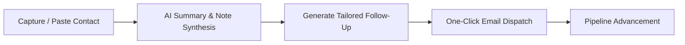

# LeadVortex AI

**Event Lead & Follow-Up Management Platform**  
A full-stack web application designed to capture, synthesize, organize, and accelerate outreach for event-driven business leads using integrated artificial intelligence.

---

## Quick Start

### Prerequisites
- Node.js 18.0.0 or higher
- npm 9.0.0 or higher

### Installation & Execution

```bash
# Install dependencies
npm install

# Start development server
npm run dev
```

The application will be available at **[http://localhost:3000](http://localhost:3000)**.

> **Note:** The application includes a local heuristic AI fallback engine and functions fully without external configuration. To enable live Google Gemini LLM capabilities, provide an API key in the application Settings modal or via `.env.local`.

---

## Overview

During conferences, trade shows, and networking summits, rapid post-event follow-up significantly impacts lead conversion rates. LeadVortex AI streamlines this workflow by combining structured lead management with automated AI assistance.

### Key Capabilities

1. **Lead Intake & Extraction** — Record contacts manually or extract structured data from unstructured text, business cards, and transcription notes.
2. **Context Synthesis** — Automatically generate concise summaries, key discussion points, and action items from raw meeting notes.
3. **Automated Follow-Up Generation** — Produce personalized email drafts calibrated by communication tone, complete with direct mail client integration.
4. **Pipeline Tracking** — Track lead progression through five pipeline stages using either tabular or Kanban board views.

---

## Core Features

| Feature | Details |
|---|---|
| **Dual Interface Views** | Interactive data table with sorting and filtering, alongside a 5-stage Kanban pipeline board. |
| **Meeting Notes Summarizer** | AI-assisted extraction of pain points, business context, next steps, and urgency classification. |
| **Follow-Up Generator** | Context-aware email drafting with configurable tones (Warm & Professional, Executive Brief, Solution Pitch, Casual Coffee). |
| **Smart Text Extraction** | Parses unformatted text and notes to populate contact fields automatically. |
| **Filtering & Search** | Multi-attribute search supporting query text, event origin, priority levels, and custom tags. |
| **Analytics & Export** | Pipeline conversion tracking, event-yield breakdown, and 1-click CSV data export for CRM integration. |

---

## Application Workflow



1. **Create Lead**: Add a new contact record or utilize Smart Capture to parse raw text.
2. **Review Summary**: Access the AI Summary panel to review synthesized context and action items.
3. **Draft Outreach**: Open the AI Follow-Up modal, select the desired tone, and generate tailored outreach copy.
4. **Dispatch**: Use the integrated mail client launcher (`mailto:`) or copy text directly for external communication tools.
5. **Manage Lifecycle**: Advance lead status across the Kanban board from *Pending* through *Closed*.

---

## Configuration

The application is pre-configured with a zero-dependency fallback engine. Live AI generation can be configured via Google Gemini:

### Option 1: In-App Configuration
Open the **Settings** dialog from the navigation bar and enter your Gemini API key.

### Option 2: Environment Variable
Create a `.env.local` file in the project root directory:

```env
GEMINI_API_KEY=your_gemini_api_key_here
```

---

## Technical Stack

- **Frontend**: React 19, Tailwind CSS, Lucide React
- **Fullstack Framework**: Next.js (App Router)
- **Database**: SQLite (via `better-sqlite3`, stored locally at `data/leads.db`)
- **AI Processing**: Google Gemini 1.5 Flash with built-in contextual fallback

---

## Project Structure

```text
├── src/
│   ├── app/
│   │   ├── api/leads/        # CRUD operations, search, and filtering
│   │   ├── api/ai/           # Summarization, email drafting, text extraction
│   │   ├── api/stats/        # Pipeline analytics and aggregate metrics
│   │   ├── api/export/       # CSV export generation
│   │   ├── globals.css       # Design tokens and styling
│   │   └── page.js           # Main application shell and state orchestrator
│   ├── components/           # UI components (Table, Kanban, Modals, Analytics)
│   └── lib/                  # Database management and AI client logic
├── data/leads.db             # Local SQLite database file
└── package.json
```

---

## REST API Reference

| Method | Endpoint | Description |
|---|---|---|
| `GET` | `/api/leads` | Retrieve leads with optional search, event, status, priority, and sorting parameters |
| `POST` | `/api/leads` | Create a new lead record |
| `GET` | `/api/leads/:id` | Retrieve a specific lead by ID |
| `PUT` | `/api/leads/:id` | Update an existing lead record or pipeline status |
| `DELETE` | `/api/leads/:id` | Delete a lead record |
| `POST` | `/api/ai/summarize` | Generate structured summary and takeaways from notes |
| `POST` | `/api/ai/draft-message` | Generate tailored follow-up email draft based on lead context |
| `POST` | `/api/ai/smart-extract` | Parse unstructured text into structured lead attributes |
| `GET` | `/api/stats` | Retrieve aggregate metrics and event yield statistics |
| `GET` | `/api/export` | Download full dataset in CSV format |
| `POST` | `/api/seed` | Reset and initialize database with sample dataset |

---

## License

This project is licensed under the MIT License.

